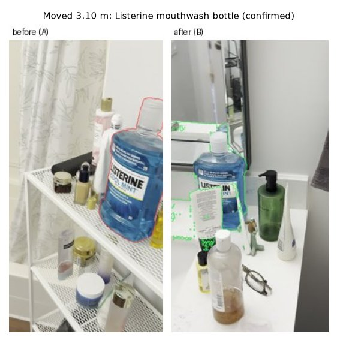
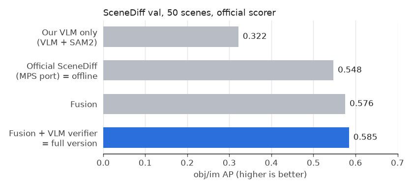
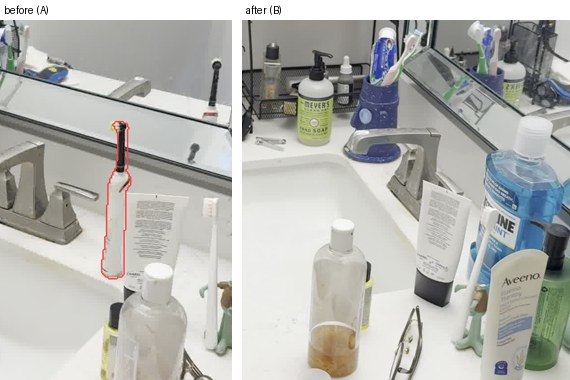

# What Changed in the Room?

[](https://chieler.github.io/Scene-difference/)
[](https://github.com/yuqunw/scene_diff)
[](#licenses--attribution)

> **Given two handheld phone videos of a room recorded at different times, detect objects that were added, removed, or moved.**
> Each change receives a natural-language description, before/after crops, a 3D bounding box, and geometric verification against the other video's rays in a shared metric 3D model.

**Interactive 3D Web Demos (no install required):**
- 🌟 [**Launch Online Demo (Full VLM + SceneDiff)**](https://chieler.github.io/Scene-difference/)
- ⚡ [**Launch Offline Demo (SceneDiff + CLIP)**](https://chieler.github.io/Scene-difference/offline/)

```bash
# Run on your own videos:
uv run diff.py before.mp4 after.mp4 -o out/            # Full version: SceneDiff + OpenAI VLM
uv run diff.py before.mp4 after.mp4 -o out/ --offline  # Offline version: 100% local, CLIP naming
```

---


*Headline detection from the example pair: a mouthwash bottle moved from the shelf beside the bathtub to the bathroom sink counter. Red outline shows where it was in the before video; green outline shows its new position in the after video.*

---

## 🌐 Interactive 3D Viewer Demo

Explore the reconstructed 3D space, camera trajectories, and identified changes in real time right in your browser:

👉 **[Open Live 3D Viewer](https://chieler.github.io/Scene-difference/)** | [Offline Version](https://chieler.github.io/Scene-difference/offline/)  
*(Or run locally: `python -m http.server -d docs`)*

### Navigation & Controls
- **Fly to an object**: Click any detected change in the left panel to smoothly fly the camera to its 3D bounding box and inspect the before/after crop.
- **Orbit & Pan**: Click + drag to rotate the camera; right-click + drag to pan; scroll to zoom.
- **View modes**:
  - `Diff`: Shows the after-state point cloud with grey points indicating areas never seen by the before video, plus a red "ghost" cloud for removed objects.
  - `Video A` / `Video B`: Displays the raw colored 3D reconstructions from each individual video.
  - `Show claims rejected by geometry`: Checkbox toggle to inspect candidate detections that our 3D verification correctly ruled out as false alarms.

### 3D Visual Encoding
| Color | Status | Description |
|---|---|---|
| 🟢 **Green** | **Added** | Object present only in Video B. |
| 🔴 **Red** | **Removed** | Object present only in Video A (rendered as a 3D ghost). |
| 🔵 **Blue** | **Moved** | Object displaced (connected by a yellow 3D displacement vector). |
| 🟡 **Yellow** | **Unverified** | Too small to verify in 3D, or the other video never panned across that spot. |
| ⚪ **Grey** | **Unobserved** | Space not visible from the alternate camera trajectory. |

---

## 📊 Benchmark on SceneDiff

Evaluated on all 50 scenes of the official [SceneDiff](https://github.com/yuqunw/scene_diff) validation split (`varied` subset) using the official competition evaluator ([`bench.py`](bench.py)):



| Method | `obj/im AP` *(Main)* | `obj/sc AP` | `obj/sc AP + type` | `px/im IoU` | TP / FP / FN |
|---|:---:|:---:|:---:|:---:|:---:|
| Official SceneDiff (MPS port, DINOv2-L) (= **Offline**) | 0.548 | 0.400 | 0.318 | 0.354 | 94 / 319 / 67 |
| VLM Track standalone (VLM proposals + SAM2 masks) | 0.322 | 0.323 | 0.284 | 0.520 | 69 / 45 / 92 |
| **Fusion + VLM Verifier (Demote Rejected)** (= **Full / Online**) | **0.585** | **0.522** | **0.472** | 0.490 | **110** / 348 / **51** |
| Fusion + VLM Verifier (Drop Rejected) | 0.548 | 0.494 | 0.449 | **0.605** | 100 / **91** / 61 |
| Geometry baseline (VGGT + DINOv2 patch diff, 1 scene) | 0.024 | 0.125 | — | 0.008 | — |

- **obj/im AP** (primary metric): Average precision of changed-object detection matched per frame.
- **obj/sc AP**: Average precision matched once per scene; **+ type** requires matching the change type (`added` / `removed` / `moved`).
- **px/im IoU**: Pixel overlap between predicted and ground-truth change masks.

### Key Benchmark Insights
- **Best Overall AP (`0.585 obj/im AP`, +3.7 over SceneDiff)**: Fusing SceneDiff's geometric recall with the VLM's precision and demoting unverified claims increases true positive objects from **94 to 110** and boosts scene-level classified accuracy from **0.318 to 0.472** (+15.4 points).
- **Highest Mask Precision (`0.605 px/im IoU`, +25.1 over SceneDiff)**: Dropping claims vetoed by the VLM verifier cuts false alarms by **71.5%** (from 319 down to 91), yielding sharp, clean segmentations.
- **Cross-Validation**: Selected via 2-fold cross-validation across the split (`scripts/cv_select.py`). Both folds independently select "rejected demoted", confirming generalization without tuning on the test split.

### Reproducing the Benchmark
```bash
uv run scripts/fetch_scenediff.py $(cat scripts/val_pairs.txt)   # Download the 50 val pairs
uv run scripts/vlm_track.py                   # Run VLM track -> out/pred_vlm/
uv run python bench.py out/pred_vlm           # Score VLM baseline
uv run scripts/fuse.py                        # Generate & score fusion variants
uv run scripts/verify.py                      # Run VLM verifier on SceneDiff-only objects
uv run scripts/cv_select.py                   # Run 2-fold cross-validation selection
```

---

## 🔍 Walkthrough: Example Detection

**Input:** Two phone videos of a bathroom: [`examples/input/before.mp4`](examples/input/before.mp4) and [`examples/input/after.mp4`](examples/input/after.mp4) (1080x1920 H.264, 9 seconds each, 11 MB total).

```bash
uv run diff.py examples/input/before.mp4 examples/input/after.mp4 -o out/
```

### Detections on the Example Pair
| Status | Change | Object (VLM Label) | 3D Measurement | Reason & Detector Source |
|---|---|---|---|---|
| **Confirmed** | moved | Listerine mouthwash bottle | Moved **3.10 m** | Both detectors confirmed; old & new positions measured |
| **Unverified** | removed | Black toothbrush | — | Too small (<0.5% frame) to verify in 3D; named by VLM |
| **Unverified** | removed | Small white tissue | — | Too small to verify in 3D; named by VLM |
| **Unverified** | added | Small round toiletry item | — | Too small to verify in 3D; named by VLM |
| **Rejected** | added | Blue-and-white carton | — | 3D rays prove the other video sees the same item there |
| **Rejected** | added | Mirror edge reflection | — | VLM verifier identifies it as an artifact |
| **Rejected** | added | White Aveeno lotion bottle | — | 3D check proves unchanged |

| Removed: black toothbrush (unverified) | Rejected: blue-and-white carton (geometric rejection) |
|:---:|:---:|
|  |  |

Every change includes a descriptive sentence generated by the VLM (e.g., *"The large blue bottle moved from the top of the white shelf beside the bathtub to the right side of the sink counter."*).

---

## ⚙️ How It Works

```
Video A (Before) ──┐
                   ├─► 1. Shared 3D (VGGT) ────────────► Metric Gravity-Aligned Frame
Video B (After)  ──┘          │
                              ├─► 2. Geometry Proposals ──► SceneDiff (MPS / π³ + DINOv2)
                              │
                              ├─► 3. Semantic Proposals ──► OpenAI VLM + SAM2 Masks
                              │
                              ├─► 4. Candidate Fusion ────► Match IoU ≥ 0.3 & Demote Rejected
                              │
                              ├─► 5. 3D Ray Verification ─► Free Space Carving + DINOv2 Residuals
                              │
                              └─► 6. Report & 3D WebGL ───► changes.json, report.md, viewer.html
```

1. **Joint Reconstruction (VGGT)**: Reconstructs both video sequences in a single joint forward pass (24 frames each), placing both cameras into a shared metric coordinate space with no drift or iterative registration. RANSAC floor detection establishes metric scale and the gravity-up vector.
2. **Geometric Proposal Generation**: An Apple Silicon MPS port of SceneDiff (`scenediff_mps/`) runs on synchronized frames to produce dense per-frame change candidate masks.
3. **Semantic Proposals & Tracking**: Labeled contact sheets are analyzed by the VLM to propose changed objects, types, and bounding boxes, converted to segmentations with SAM 2.1.
4. **Fusion & Verification**: Candidates detected by both systems are prioritized. Standalone candidates undergo cross-video 3D ray projection:
   - **Not Seen**: Camera never looked at that voxel $\rightarrow$ marked *Unverified*.
   - **Seen-Through**: Alternate video's camera rays pass through the voxel into open space $\rightarrow$ strong change evidence.
   - **Appearance Delta**: DINOv2 feature embeddings differ between viewpoints above the local background noise floor $\rightarrow$ *Confirmed*.
5. **Output Generation**: Produces interactive HTML 3D viewers, Markdown summary reports, crop galleries, and structured JSON.

---

## 🚀 Quickstart & Setup

### Requirements
- macOS (Apple Silicon recommended) or Linux.
- Python $\ge$ 3.10 with [`uv`](https://github.com/astral-sh/uv) installed.
- `ffmpeg` on PATH (`brew install ffmpeg` on macOS).

### Installation
```bash
# 1. Sync dependencies
uv sync

# 2. Setup SceneDiff models & weights (downloads SAM ViT-H, π³, and DINOv2)
bash scripts/setup_scenediff.sh
```

### Running Change Detection
```bash
# Option A: Full Online Version (requires OpenAI API key or codex CLI)
export OPENAI_API_KEY="sk-..."
uv run diff.py before.mp4 after.mp4 -o out/

# Option B: 100% Offline Version (uses local CLIP & geometry, zero API calls)
uv run diff.py before.mp4 after.mp4 -o out/ --offline

# Option C: Fast Mode (skips SceneDiff stage, runs in ~8 minutes)
uv run diff.py before.mp4 after.mp4 -o out/ --detector fast
```

### Runtime & Memory (Tested on 16 GB M2 Mac)
| Stage | Duration | Peak RAM |
|---|---|---|
| Reconstruction (VGGT) | ~5.5 min | ~8.2 GB |
| SceneDiff Candidate Stage | ~22 min | ~12.7 GB *(freed immediately after)* |
| 3D Verification & VLM Verification | ~3.5 min | ~5.1 GB |
| **Total End-to-End** | **~30 min** *(re-runs with cache take <1 min)* | **12.7 GB** |

---

## 📂 Output Data Structure

Outputs are generated in the directory specified by `-o`:
- `viewer.html`: Self-contained interactive 3D Three.js viewer with embedded point clouds.
- `report.md`: Markdown summary highlighting confirmed, unverified, and rejected objects with crops.
- `changes/`: High-resolution before/after crops with object masks outlined (red = before, green = after).
- `changes.json`: Complete machine-readable output:
  - `type`: `added` | `removed` | `moved`
  - `label` & `description`: Semantic name and descriptive sentence.
  - `status` & `why`: `confirmed` | `unverified` | `rejected` with explanation.
  - `lo`, `hi`: 3D bounding box corners in meters.
  - `from_lo`, `from_hi`, `shift_m`: Original position and displacement distance for moved objects.
  - `evidence` & `context`: 3D ray metrics (`seen`, `gone`, `differs`).

---

## 📁 Code Architecture

| File | Role |
|---|---|
| [`diff.py`](diff.py) | Main CLI entry point: caching, detector selection, report generation, and 3D viewer packaging |
| [`recon.py`](recon.py) | VGGT joint dual-video reconstruction & RANSAC floor metric alignment |
| [`official.py`](official.py) | Apple-silicon MPS wrapper for SceneDiff: dense geometric change masks |
| [`fusion.py`](fusion.py) | Candidate fusion: matching geometric masks with VLM proposals, verifier re-ranking, and CLIP classification |
| [`vlm.py`](vlm.py) | OpenAI vision backend (API & codex CLI) and crop-sheet verification engine |
| [`semantic.py`](semantic.py) | VLM proposal extraction, SAM2 segmentation, 3D point cloud lifting & ray verification |
| [`label.py`](label.py) | Local CLIP zero-shot classification (offline mode) |
| [`viewer.py`](viewer.py) | Self-contained Three.js 3D WebGL viewer generator |
| [`bench.py`](bench.py) | Official SceneDiff benchmark evaluation runner |
| [`scenediff_mps/`](scenediff_mps/) | Vendored MIT SceneDiff pipeline ported to Apple Silicon MPS |

---

## 📜 Licenses & Attribution

- **SceneDiff**: MIT License (Yuqun Wu et al.). Ported to Apple Silicon MPS under `scenediff_mps/`. See `scenediff_mps/NOTICE.md`.
- **$\pi^3$**: Non-commercial research license.
- **Example Inputs**: Video sequences sourced from the [SceneDiff](https://github.com/yuqunw/scene_diff) benchmark (`bathroom_1_bathroom_2`).
