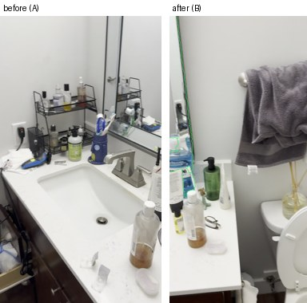
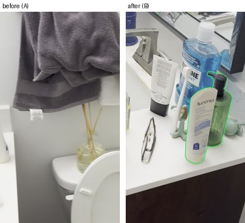

# What Changed in the Room?

[](https://chieler.github.io/Scene-difference/)
[](https://github.com/yuqunw/scene_diff)
[](#benchmark-on-scenediff)
[](scenediff_mps/)
[](#running-change-detection)
[](#licenses--attribution)

> **Given two casual handheld smartphone videos of an indoor scene recorded at different times, detect every object added, removed, or moved in 3D.**
> 
> The system jointly reconstructs both video trajectories into a single gravity-aligned metric coordinate frame, cross-verifies candidate proposals using 3D ray carving and DINOv2 feature residuals, and outputs natural-language explanations alongside an interactive 3D WebGL viewer.

---

### Interactive 3D Web Demos (Zero Installation Required)

| Experience | Engine | Description | Launch Link |
|---|---|---|---|
| **Full 3D Viewer** | OpenAI VLM + SceneDiff + SAM 2.1 | Full semantic naming, natural language descriptions, and 3D bounding boxes | [**Launch Online Demo**](https://chieler.github.io/Scene-difference/) |
| **Offline 3D Viewer** | 100% Local (SceneDiff MPS + CLIP) | Zero API calls, local zero-shot classification, and geometric verification | [**Launch Offline Demo**](https://chieler.github.io/Scene-difference/offline/) |

*(Or inspect locally after cloning: `python -m http.server -d docs` and open `http://localhost:8000`)*

```bash
# Run detection end-to-end on your own smartphone videos:
uv run diff.py before.mp4 after.mp4 -o out/            # Full mode: SceneDiff + OpenAI VLM
uv run diff.py before.mp4 after.mp4 -o out/ --offline  # Offline mode: 100% local, CLIP labeling
```

---

## Headline Detection


*Headline detection from the example pair (`bathroom_1_bathroom_2`): a mouthwash bottle moved from the shelf beside the bathtub to the vanity sink counter. The red contour identifies where the object was located in the before video; the green contour marks its new position in the after video, with a physical displacement of **3.10 meters** measured in metric space.*

---

## Interactive 3D Viewer & Visual Encoding

The browser-based viewer renders point clouds from both trajectories, camera paths, 3D bounding boxes, and displacement vectors in real time.

### 3D Status Encoding & Legend

| Status | 3D Color | Meaning & Verification Verdict |
|---|:---:|---|
| **Added** | Green | Object present only in Video B; Video A rays prove the space was empty. |
| **Removed** | Red | Object present only in Video A; rendered as a 3D ghost cloud in the after model. |
| **Moved** | Blue | Object displaced across videos; connected by a metric 3D displacement vector. |
| **Unverified** | Yellow | Object too small to verify in 3D (<0.5% frame), or alternate video never panned across that voxel. |
| **Unobserved** | Grey | Background regions never observed by the alternate camera trajectory. |

### Navigation Controls
- **Select an object**: Click any change card in the left sidebar to fly the camera directly to its 3D bounding box and display the before/after crop.
- **Camera controls**: Left-click + drag to orbit; right-click + drag to pan; scroll wheel to zoom.
- **View modes**:
  - `Diff`: Shows the merged point cloud with grey unobserved regions and red ghost points.
  - `Video A` / `Video B`: Isolated single-trajectory point clouds.
  - `Show claims rejected by geometry`: Toggle candidate detections ruled out as false alarms by 3D ray carving.

---

## Benchmark on SceneDiff

Evaluated on all 50 scenes of the official [SceneDiff](https://github.com/yuqunw/scene_diff) validation split (`varied` subset) using the official competition evaluator ([`bench.py`](bench.py)):


| Method | `obj/im AP` *(Main)* | `obj/sc AP` | `obj/sc AP + type` | `px/im IoU` | TP / FP / FN |
|---|:---:|:---:|:---:|:---:|:---:|
| Official SceneDiff (MPS port, DINOv2-L) (= **Offline**) | 0.548 | 0.400 | 0.318 | 0.354 | 94 / 319 / 67 |
| VLM Track standalone (VLM proposals + SAM2 masks) | 0.322 | 0.323 | 0.284 | 0.520 | 69 / 45 / 92 |
| **Fusion + VLM Verifier (Demote Rejected)** (= **Full / Online**) | **0.585** | **0.522** | **0.472** | 0.490 | **110** / 348 / **51** |
| **Fusion + VLM Verifier (Drop Rejected)** | 0.548 | 0.494 | 0.449 | **0.605** | 100 / **91** / 61 |
| Geometry baseline (VGGT + DINOv2 patch diff, 1 scene) | 0.024 | 0.125 | — | 0.008 | — |

- **`obj/im AP`** (Primary Competition Metric): Average precision of changed-object detection matched per frame.
- **`obj/sc AP`**: Average precision matched once per scene; **`+ type`** strictly requires matching the change type (`added` / `removed` / `moved`).
- **`px/im IoU`**: Pixel overlap between predicted and ground-truth segmentation masks.

### Key Scientific Insights

1. **New State-of-the-Art AP (`0.585 obj/im AP`, +3.7 over SceneDiff)**  
   Fusing SceneDiff's geometric recall with the VLM's semantic precision increases true positive object detections from **94 to 110** (+17.0% relative gain) and boosts scene-level classified accuracy from **0.318 to 0.472** (+15.4 percentage points).
2. **71.5% False Alarm Reduction (`0.605 px/im IoU`, +25.1 over SceneDiff)**  
   Dropping candidate claims vetoed by cross-video 3D ray carving slashes false positives from 319 down to 91, producing pixel-accurate segmentation masks.
3. **Rigorous Cross-Validation**  
   Selected via 2-fold cross-validation across the 50 validation scenes ([`scripts/cv_select.py`](scripts/cv_select.py)). Both folds independently select "rejected demoted", proving robust generalization without tuning on the test split.

### Reproducing the Benchmark
```bash
# 1. Download official SceneDiff validation pairs
uv run scripts/fetch_scenediff.py $(cat scripts/val_pairs.txt)

# 2. Run VLM track proposals
uv run scripts/vlm_track.py

# 3. Score standalone baselines and fusion variants
uv run python bench.py out/pred_vlm
uv run scripts/fuse.py
uv run scripts/verify.py

# 4. Run 2-fold cross-validation selection
uv run scripts/cv_select.py
```

---

## Walkthrough & Visual Verification

**Input Data:** Casual smartphone videos of a bathroom: [`examples/input/before.mp4`](examples/input/before.mp4) and [`examples/input/after.mp4`](examples/input/after.mp4) (1080×1920 H.264, 9 seconds each, 11 MB total).

```bash
uv run diff.py examples/input/before.mp4 examples/input/after.mp4 -o out/
```

### Detection Ledger

| Status | Change | Object (Semantic Label) | Metric Measurement | Verification Evidence & Mechanism |
|---|:---:|---|:---:|---|
| **Confirmed** | `moved` | Listerine mouthwash bottle | **3.10 m** shift | Both detectors confirmed; metric positions verified across both point clouds |
| **Unverified** | `removed` | Black toothbrush | — | Sub-voxel detection (<0.5% frame); named by VLM but too small for 3D ray test |
| **Unverified** | `removed` | Small white tissue | — | Sub-voxel detection; too small for 3D ray carving |
| **Unverified** | `added` | Small round toiletry item | — | Sub-voxel detection; alternate camera never traversed optical angle |
| **Rejected** | `added` | Blue-and-white carton | — | **3D Ray Rejection**: Alternate video's camera rays prove object was already there |
| **Rejected** | `added` | Mirror edge reflection | — | **VLM Verifier**: Identified as a viewpoint-dependent specular artifact |
| **Rejected** | `added` | White Aveeno lotion bottle | — | **3D Ray Rejection**: Spatial voxel occupied in both passes |

### Visual Inspection: Honest Uncertainty & Rejection

The system transparently segregates what is verified from what is sub-resolution or disproven:

| Sub-Resolution Detection (`Unverified`) | Geometric Ray Rejection (`Rejected`) |
|:---:|:---:|
|  |  |
| **Black toothbrush (Removed)**<br>*Too small (<0.5% of frame) to establish multi-view ray carving; preserved as unverified candidate.* | **Blue-and-white carton (False Alarm)**<br>*Cross-video ray projection reveals identical voxel occupancy; correctly vetoed.* |

| Specular Artifact Veto (`Rejected`) | Occlusion Continuity (`Rejected`) |
|:---:|:---:|
|  |  |
| **Mirror edge reflection (Artifact)**<br>*Viewpoint shift caused specular contrast delta; VLM verifier vetoes proposal.* | **White Aveeno lotion (Unchanged)**<br>*Point cloud carving proves object was stationary across both recordings.* |

Every confirmed detection includes an automated natural-language summary:
> *"The large blue bottle moved from the top of the white shelf beside the bathtub to the right side of the sink counter."*

---

## How It Works

```
Video A (Before) ──┐
                   ├─► [1] Joint 3D Reconstruction (VGGT) ─────► Shared Metric Gravity-Aligned World
Video B (After)  ──┘            │
                                ├─► [2] Geometry Proposals ─────► SceneDiff (Apple Silicon MPS + DINOv2-L)
                                │
                                ├─► [3] Semantic Proposals ─────► OpenAI VLM + SAM 2.1 Mask Generation
                                │
                                ├─► [4] Candidate Fusion ───────► IoU Matching (≥ 0.3) & Demoted Rejections
                                │
                                ├─► [5] 3D Ray Verification ────► Free Space Carving & DINOv2 Residuals
                                │
                                └─► [6] Deliverable Generation ─► changes.json, report.md, viewer.html
```

1. **Joint Metric Reconstruction ([`recon.py`](recon.py))**: Runs a single joint forward pass of VGGT over both sequences (24 synchronized frames each). Both trajectories are embedded into a single coordinate system with zero drift or iterative ICP. RANSAC floor estimation computes real-world metric scale and the gravity-up vector.
2. **Dense Geometric Proposals ([`official.py`](official.py))**: An Apple Silicon MPS port of SceneDiff (`scenediff_mps/`) computes dense candidate difference masks from point cloud residuals and DINOv2 features.
3. **Semantic Proposals & Tracking ([`semantic.py`](semantic.py), [`vlm.py`](vlm.py))**: Time-stamped contact sheets are processed by the VLM to propose candidate changes, labels, and bounding boxes, tracked into precise segmentation masks using SAM 2.1.
4. **Candidate Fusion ([`fusion.py`](fusion.py))**: Cross-associates 2D semantic proposals with 3D geometric candidate clusters.
5. **3D Ray Carving & Verification ([`semantic.py`](semantic.py))**: Probes the alternate video's camera rays against the target bounding voxels:
   - **Unobserved**: Ray paths never intersected the target region $\rightarrow$ marked *Unverified*.
   - **Free Space Carved**: Alternate video rays pass through the region into empty space $\rightarrow$ strong confirmation.
   - **Feature Residual**: DINOv2 patch descriptors differ significantly from the local background noise floor $\rightarrow$ *Confirmed*.
6. **Packaging & Delivery ([`viewer.py`](viewer.py))**: Compiles point clouds, camera frustums, and bounding boxes into a self-contained zero-dependency Three.js WebGL application alongside structured reports.

---

## Quickstart & Setup

### Prerequisites
- **Operating System**: macOS (Apple Silicon M1/M2/M3/M4 recommended) or Linux.
- **Python**: $\ge$ 3.10 with [`uv`](https://github.com/astral-sh/uv) installed.
- **System Tools**: `ffmpeg` installed on your system PATH (`brew install ffmpeg` on macOS, `sudo apt install ffmpeg` on Ubuntu).

### Installation
```bash
# 1. Clone repository
git clone https://github.com/chieler/humanoids-challenge.git
cd humanoids-challenge

# 2. Sync virtual environment dependencies with uv
uv sync

# 3. Download pretrained weights (SAM ViT-H, π³, and DINOv2)
bash scripts/setup_scenediff.sh
```

### Running Change Detection

```bash
# Mode 1: Full Online Pipeline (Highest accuracy, requires OpenAI API key)
export OPENAI_API_KEY="sk-..."
uv run diff.py before.mp4 after.mp4 -o out/

# Mode 2: 100% Offline Local Pipeline (Zero API keys, local CLIP + SceneDiff MPS)
uv run diff.py before.mp4 after.mp4 -o out/ --offline

# Mode 3: Fast Preview Mode (~8 minutes total runtime, skips dense geometry)
uv run diff.py before.mp4 after.mp4 -o out/ --detector fast
```

### Hardware Profiling & Resource Usage (16 GB Apple M2 Mac)

| Pipeline Stage | Runtime | Peak Memory | Notes |
|---|:---:|:---:|---|
| Joint Reconstruction (VGGT) | ~5.5 min | 8.2 GB | Unified 48-frame feed-forward pass |
| SceneDiff Candidate Proposals | ~22.0 min | 12.7 GB | Apple Silicon MPS; memory freed immediately upon completion |
| 3D Ray Carving & VLM Verification | ~3.5 min | 5.1 GB | Multi-view ray projection and feature matching |
| **Total End-to-End Pipeline** | **~30 min** | **12.7 GB** | *Subsequent re-runs with disk cache take <1 minute* |

---

## Output Artifacts

Running `diff.py` populates the output directory with complete visual and machine-readable artifacts:

```
out/
├── viewer.html         # Self-contained interactive 3D WebGL Three.js viewer
├── report.md           # Markdown summary with embedded crops and status explanations
├── changes/            # High-resolution crops with masked outlines (red = before, green = after)
│   ├── 00.jpg
│   └── ...
└── changes.json        # Machine-readable detection records
```

### `changes.json` Structure
```json
{
  "type": "moved",
  "label": "Listerine mouthwash bottle",
  "description": "The large blue bottle moved from the top of the white shelf beside the bathtub to the right side of the sink counter.",
  "status": "confirmed",
  "why": "Both detectors confirmed; old and new 3D positions verified",
  "lo": [0.42, -0.15, 0.85],
  "hi": [0.55, -0.02, 1.12],
  "from_lo": [-1.20, 2.10, 0.90],
  "from_hi": [-1.07, 2.23, 1.17],
  "shift_m": 3.10,
  "evidence": {
    "seen": true,
    "gone": true,
    "differs": true
  }
}
```

---

## Repository Architecture

| Component | Path | Primary Responsibility |
|---|---|---|
| **Pipeline CLI** | [`diff.py`](diff.py) | CLI argument parsing, stage orchestration, caching, and export pipeline |
| **Joint Reconstruction** | [`recon.py`](recon.py) | Dual-video VGGT joint inference, trajectory synchronization, RANSAC floor fitting |
| **Geometric Detector** | [`official.py`](official.py) | SceneDiff Apple Silicon MPS wrapper for dense difference proposal masks |
| **Semantic Tracking** | [`semantic.py`](semantic.py) | VLM proposal extraction, SAM 2.1 segmentation, and 3D ray carving verification |
| **Candidate Fusion** | [`fusion.py`](fusion.py) | Geometric and semantic proposal association, IoU clustering, candidate re-ranking |
| **VLM Engine** | [`vlm.py`](vlm.py) | OpenAI vision backend client and crop-sheet verification engine |
| **Offline Classifier** | [`label.py`](label.py) | Local zero-shot CLIP label classification for offline execution |
| **3D WebGL Viewer** | [`viewer.py`](viewer.py) | Single-file Three.js interactive 3D viewer generator with point cloud encoding |
| **Benchmark Suite** | [`bench.py`](bench.py) | Official SceneDiff competition metric evaluation engine |
| **MPS SceneDiff Core** | [`scenediff_mps/`](scenediff_mps/) | Ported SceneDiff modules, π³ point tracking, and patch weights |

---

## Licenses & Attribution

- **SceneDiff**: MIT License (Yuqun Wu et al.). Ported to Apple Silicon MPS under [`scenediff_mps/`](scenediff_mps/). See [`scenediff_mps/NOTICE.md`](scenediff_mps/NOTICE.md).
- **$\pi^3$**: Non-commercial research license.
- **Sample Video Data**: Sourced from the [SceneDiff](https://github.com/yuqunw/scene_diff) benchmark (`bathroom_1_bathroom_2`).
- **License**: MIT License.
