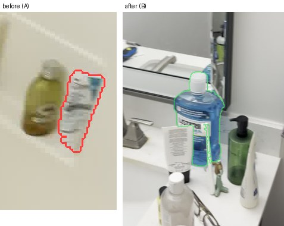
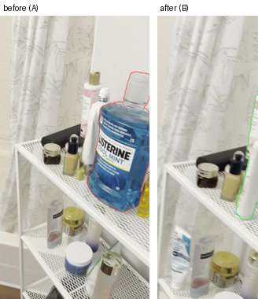

# What changed in the room?

Give it two phone videos of the same room, recorded at different times. It builds one shared 3D model from both and finds the objects that were added, removed or moved. Each change gets a name, a sentence, a 3D box, a before/after picture, and a verdict from geometry on whether it is real. Two detectors that fail in opposite ways do the finding: the official [SceneDiff](https://github.com/yuqunw/scene_diff) method (catches nearly everything, plus many false alarms) and an OpenAI vision-language model (names things well, rarely invents changes, misses small ones). The 3D model then judges each claim against what the other video actually saw. On the SceneDiff benchmark the combination beats both detectors on their own (obj/im AP 0.585, against 0.548 and 0.322).

```
uv run diff.py before.mp4 after.mp4 -o out/            # full version: SceneDiff + OpenAI VLM (API key or codex CLI)
uv run diff.py before.mp4 after.mp4 -o out/ --offline  # offline version: same candidates, CLIP names, no API calls
```


*The headline change from the committed example: the mouthwash moved from the shelf beside the bathtub to the sink counter. Red outline is where it was in the before video, green is where it is in the after video.*

## Example: full (OpenAI VLM) version

<!-- EXAMPLE: replace stand-in with own videos -->
**Input** (stand-in until our own video pair is added): the SceneDiff pair `bathroom_1_bathroom_2`, copied unchanged to [`examples/input/before.MOV`](examples/input/before.MOV) and [`examples/input/after.MOV`](examples/input/after.MOV) (1920x1080 HEVC, about 9 s each, 29 MB together).

```
uv run diff.py examples/input/before.MOV examples/input/after.MOV -o out/standin_full
```

**Output**, committed in [`examples/full/`](examples/full/):

| File | What it is |
|---|---|
| [`report.md`](examples/full/report.md) | Confirmed, unverified and rejected changes, each with its reason and a before/after picture |
| [`changes/NN.jpg`](examples/full/changes/) | Before/after crop per change, object outlined (red = before, green = after) |
| [`changes.json`](examples/full/changes.json) | Everything, machine-readable (fields below) |
| [`viewer.html`](examples/full/viewer.html) | Interactive 3D viewer (how to open it below) |

What the report says (7 objects, from [`report.md`](examples/full/report.md)):

| Status | Change | Object (VLM label) | 3D result | Found by |
|---|---|---|---|---|
| **confirmed** | moved | Listerine mouthwash bottle | moved 3.10 m | both detectors |
| unverified | removed | black toothbrush | too small to check in 3D | SceneDiff, named by the VLM |
| unverified | removed | small white tissue | too small to check in 3D | SceneDiff, named by the VLM |
| unverified | added | small round toiletry item | too small to check in 3D | SceneDiff, named by the VLM |
| rejected | added | blue-and-white carton | the other video sees the same thing there | both detectors |
| rejected | added | mirror edge | the VLM sees no change here | SceneDiff, vetoed by the VLM |
| rejected | added | white Aveeno lotion bottle | the other video sees the same thing there | VLM |

Every entry also has a sentence from the VLM, e.g. *"The large blue bottle moved from the top of the white shelf beside the bathtub to the right side of the sink counter."* Rejected claims stay in the output with their reason, so you can see what was ruled out and why.

| Removed: black toothbrush (unverified) | Rejected: blue-and-white carton |
|---|---|
|  |  |

For reference, the dataset's ground truth for this pair lists four changed objects: the mouthwash and a cream moved, two small eye-contact lotion bottles removed. The full version confirms the mouthwash. It does not report the other three.

**`changes.json`**, one object per change:

| Field | Meaning |
|---|---|
| `type`, `label`, `description`, `text` | added / removed / moved; VLM name; VLM sentence; the report line |
| `status`, `why` | confirmed / unverified / rejected, and the reason |
| `source` | `both`, `official` (SceneDiff only) or `vlm` (VLM only) |
| `lo`, `hi` | 3D box in meters (gravity-up, scale from the floor); for moved objects, the new position |
| `from_lo`, `from_hi`, `shift_m` | moved objects: old box and the distance between the two |
| `evidence`, `context` | 3D check on the object and on a background ring around it: fraction `seen` by the other video, `gone` (seen through to free space), `differs` (DINOv2 features don't match) |
| `score`, `support` | ranking score (band: both detectors > SceneDiff-only > VLM-only); how far the object's change evidence exceeds its background ring |
| `where`, `frames`, `image` | coarse position in the room; frames per video where it appears; crop path |

**3D viewer.** `viewer.html` is self-contained (point clouds embedded, three.js from a CDN). GitHub shows it as source and won't render it, so download it or clone the repo, then:

```
python -m http.server -d examples/full    # open http://localhost:8000/viewer.html
```

Opening the file directly also works; serving the folder lets the side panel show the crops. Click a change to fly to it. Green = added, red = removed, blue = moved, yellow = unverified; grey points are space the other video never saw; a toggle shows the rejected claims.

## Benchmark

[SceneDiff](https://github.com/yuqunw/scene_diff) has 50 validation pairs of real room videos with per-frame masks of every changed object. All rows: val split, "varied" set, 50 scenes, official evaluator (`bench.py` wraps `third_party/scene_diff/scripts/evaluate_multiview.py`).


| Method | px/im IoU | obj/im AP | obj/sc AP | obj/sc AP + type | TP / FP / FN |
|---|---|---|---|---|---|
| Our earlier VLM-only approach: VLM proposals + SAM2 masks (`scripts/vlm_track.py`) | 0.520 | 0.322 | 0.323 | 0.284 | 69 / 45 / 92 |
| Official SceneDiff method, our MPS port, DINOv2-L in place of gated DINOv3 (= **offline version**) | 0.354 | 0.548 | 0.400 | 0.318 | 94 / 319 / 67 |
| Fusion of the two (`scripts/fuse.py`) | 0.490 | 0.576 | 0.498 | 0.448 | 110 / 348 / 51 |
| **Fusion + VLM verifier, rejected ranked last (= full version)** (`scripts/verify.py`) | 0.490 | **0.585** | **0.522** | **0.472** | 110 / 348 / 51 |
| Fusion + VLM verifier, rejected dropped | **0.605** | 0.548 | 0.494 | 0.449 | 100 / 91 / 61 |
| Geometry only: VGGT + DINOv2 object diff (`objdiff.py`), 1 scene | 0.008 | 0.024 | 0.125 | | |

- **obj/im AP** (main metric): average precision of changed-object detection, matched per frame.
- **obj/sc AP**: the same, matched once per scene; **+ type** also requires the right added/removed/moved.
- **px/im IoU**: pixel overlap of predicted and true change masks per frame.

Against the official SceneDiff method (= the offline version), the two verifier variants trade off like this:

| | Full version: rejected ranked last | Precision variant: rejected dropped |
|---|---|---|
| obj/im AP | **+3.7 points** (0.548 → 0.585) | ±0 (0.548) |
| obj/sc AP + type | **+15.4 points** (0.318 → 0.472) | +13.1 points (0.449) |
| px/im IoU | +13.6 points (0.490) | **+25.1 points** (0.605) |
| true positives / misses | 94 → **110** / 67 → **51** | 94 → 100 / 67 → 61 |
| false alarms | 319 → 348 (rejected ones stay, ranked last) | 319 → **91** (−71%) |

The CLI gives both views: the report and viewer set rejected objects apart under "Rejected" (the precision view), while `changes.json` keeps every object with its status and score, so nothing is lost.

**Is 0.585 tuned on the test data?** The variant was picked by 2-fold cross-validation (`scripts/cv_select.py`): the scenes are split in two halves, each half picks the best variant on the other half, and the two held-out halves are scored together. Both halves pick "rejected ranked last", so the held-out score is the same 0.585. The fusion match threshold (mask IoU 0.3) was set once and not tuned.

The official method has high recall and 319 false alarms; the VLM is usually right but misses small objects. The fusion ranks objects both found first, then the official method's other objects, then the VLM's. The verifier shows the VLM each object only the official method found, as an outlined crop next to both videos, and asks if it is a real change. It keeps 64 of 331; dropping the rest cuts false alarms from 348 to 91 (best px/im IoU), while ranking them last keeps the recall (best AP).

The VLM runs went through the `codex` CLI on the benchmark's own frames. The paper reports its numbers on the test split, so they are not directly comparable. To reproduce:
```
uv run scripts/fetch_scenediff.py $(cat scripts/val_pairs.txt)   # the 50 val pairs -> data/scenediff
uv run scripts/vlm_track.py                   # -> out/pred_vlm/<scene>/object_masks.pkl
uv run scripts/locate.py out/pred_vlm         # 3D position per object -> objects.json
uv run python bench.py out/pred_vlm           # official scorer
# official method: see scenediff_mps/PORT_NOTES.md (about 7.5 h for 50 scenes on a 16 GB Mac)
uv run scripts/fuse.py                        # fusion variants, scored
uv run scripts/verify.py                      # VLM verifier on the official-only objects, scored
uv run scripts/cv_select.py                   # 2-fold CV over the variants
uv run scripts/figures.py                     # README figures
```

## Offline version

`--offline` keeps the SceneDiff candidates and the same 3D check, and replaces the VLM with CLIP for the names. No API calls, no network after setup. Its detections are the official method's (obj/im AP 0.548). It loses the VLM's sentences, its names, its veto on false alarms, and the objects only the VLM found.

Same input, output in [`examples/offline/`](examples/offline/) ([`report.md`](examples/offline/report.md), `changes/`, `changes.json`, `viewer.html`):

| Status | Change | Offline (CLIP label) | Full version on the same object |
|---|---|---|---|
| confirmed | moved 3.14 m | bottle | Listerine mouthwash bottle, moved 3.10 m (but see below) |
| confirmed | moved 0.22 m | bottle | not reported |
| unverified | removed | box | black toothbrush |
| unverified | added | toy | small round toiletry item |
| unverified | removed | chair | small white tissue |
| rejected | added | shelf | blue-and-white carton (rejected in 3D) |
| rejected | added | mirror | mirror edge (vetoed by the VLM) |

| Offline "moved 3.14 m": wrong before object | Offline "moved 0.22 m": wrong after object |
|---|---|
|  |  |

What differs on this pair:
- **Names.** CLIP picks from a fixed vocabulary: the toothbrush becomes "box", the tissue "chair". The VLM names are right.
- **Moved pairs.** Offline, "moved" comes from SceneDiff's appearance match between the two videos. Here it mispaired both: the 3.14 m move has a small item in the before picture and the mouthwash in the after picture; the 0.22 m move has the mouthwash before and a shower-curtain edge after. The full version builds the moved pair from the VLM's claim and reports one correct move.
- **Rejections.** Both reject the shelf/carton and the mirror, but offline only by geometry; the full version's VLM vetoes the mirror edge on its own.

## How it works

1. **Shared 3D.** [VGGT](https://github.com/facebookresearch/vggt) reconstructs both videos in a single forward pass (24 frames each), so both come out in one coordinate frame with no registration step. The frame is rotated gravity-up and scaled to meters from a RANSAC floor fit.
2. **Candidates from geometry.** The SceneDiff method (ported to Apple-silicon GPUs, `official.py`, `scenediff_mps/`) runs on the same 24 + 24 frames and returns per-frame masks of objects that may have changed.
3. **Claims from the VLM** (full). The VLM sees both videos as labeled contact sheets and returns, per change, a name, a sentence, a type and a box in every frame where it appears. SAM2 turns boxes into masks.
4. **Fuse.** A candidate whose masks overlap a VLM claim is the same object: ranked first, named by the VLM. Each remaining candidate is shown to the VLM as an outlined crop next to both videos, and named or vetoed. Offline, CLIP names the candidates instead.
5. **3D check against the other video.** VGGT depth lifts each mask into the shared frame; its points are projected into every frame of the other video:
   - **not seen**: the other video never looked there, or something was in the way. The claim is *unverified*, not *removed*.
   - **seen through**: the other video sees past the spot into free space. Strongest evidence of a change.
   - **looks different**: DINOv2 features at the spot don't match.

   Each object is scored relative to a ring of background around it, which has the same registration noise, so only evidence above that floor counts. A "moved" object whose two positions coincide is rejected.
6. **Present.** Report, crops, `changes.json`, 3D viewer.

Other modes: `--detector fast` runs only the VLM claims plus the 3D check (about 8 minutes, no SceneDiff stage, lower recall). `--detector geometry` runs the first, voxel-diff detector.

## Setup

- `uv sync`; ffmpeg on PATH (`brew install ffmpeg`).
- `bash scripts/setup_scenediff.sh` (both versions). It clones π³ and the SceneDiff SAM fork at pinned commits, applies the MPS patches from `scenediff_mps/patches/`, and downloads the SAM ViT-H checkpoint (2.6 GB, sha256-checked) and the π³ and DINOv2-L weights.
- Full version, one of:
  - `export OPENAI_API_KEY=...`, optional `OPENAI_MODEL` (default `gpt-5`);
  - or the [codex CLI](https://github.com/openai/codex), logged in; used when no key is set.

  Without `--offline`, `diff.py` picks the full version when either is available and falls back to offline otherwise.
- The first run downloads VGGT-1B, π³, SAM ViT-H, SAM2.1-base+, DINOv2-base and -large, CLIP ViT-L/14. Uses MPS when available, else CPU. Tested on an M-series Mac with 16 GB.

**Run time and memory**, 16 GB M2, the example pair:

| Stage | Time |
|---|---|
| Reconstruction (VGGT) | about 5.5 min |
| SceneDiff stage | about 22 min |
| 3D check (offline) / VLM calls + 3D check (full) | about 2 min / about 3.5 min |
| **Total**, either version | **about 30 min**; reruns use the caches and take about a minute |
| `--detector fast` | about 8 min |

Peak memory is 12.7 GB: the SceneDiff stage runs in its own process and frees its memory before the rest continues. The VLM calls cost a few cents per run with the OpenAI API.

**Recording tips:** 20 to 30 s per video, slow pan, same phone orientation for both; keep the floor in view for metric scale (otherwise positions are in VGGT units); film the second video from a different spot; change 2 to 3 objects in between.

## Limits

- Objects under about 0.5% of the frame are too small to test in 3D and are reported as unverified (three of the seven in the example).
- A person walking through can be reported as a change.
- The SceneDiff stage dominates the run time (SAM ViT-H on 48 frames). `--detector fast` skips it at lower recall.
- Offline, "moved" can pair an object with a different, similar-looking one (see above).
- One shared VGGT pass means all 48 frames go through the model at once; that fits in 16 GB, more frames may not.

## Licenses

- π³ is licensed for **non-commercial use only**, so the SceneDiff candidate path (both versions) is for research and evaluation.
- The SceneDiff method in `scenediff_mps/` is MIT (Yuqun Wu et al.), vendored with our MPS changes; see `scenediff_mps/LICENSE` and `scenediff_mps/NOTICE.md` for every third-party component, its license, and how it is obtained.
- The example input videos are from the SceneDiff benchmark.

## Code

| File | Role |
|---|---|
| `diff.py` | CLI: reconstruction cache, detector choice, report, viewer |
| `recon.py` | VGGT joint reconstruction, floor alignment |
| `official.py` | The SceneDiff method on the sampled frames: candidate masks |
| `fusion.py` | Full and offline versions: fusing candidates with VLM claims, VLM verification or CLIP names |
| `vlm.py` | VLM backend (OpenAI API or codex CLI), crop-sheet verifier |
| `semantic.py` | VLM claims, SAM2 masks, 3D lifting, the 3D check against the other video, crops |
| `label.py` | CLIP names (offline) |
| `viewer.py` | Self-contained three.js viewer |
| `change2d.py`, `changes.py` | Geometry-only detector: DINO patch diff, free-space carving |
| `objdiff.py` | Geometry-first object pipeline, kept as the negative result in the table |
| `bench.py`, `scripts/` | SceneDiff benchmark: frame extraction, official scorer, VLM track, fusion, verifier, CV, figures |
| `scenediff_mps/`, `scripts/setup_scenediff.sh` | The SceneDiff method (MIT), ported to Apple-silicon GPUs; setup clones and patches its dependencies |
| `examples/` | Committed example input and outputs of both versions |

Tests: `uv run pytest -q`
