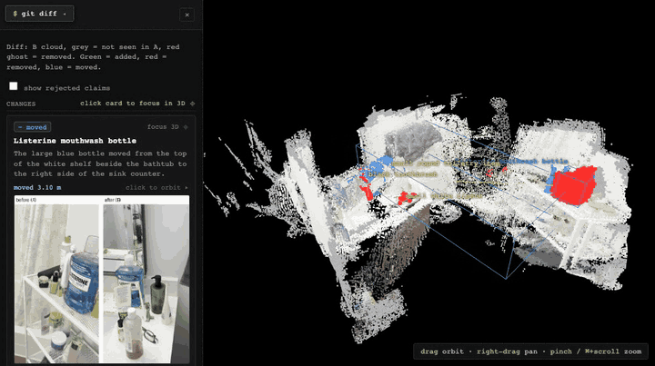
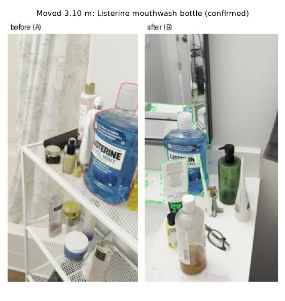
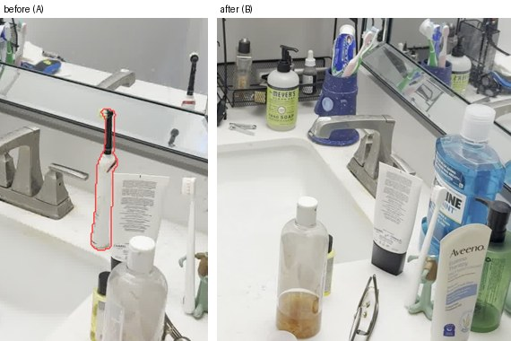
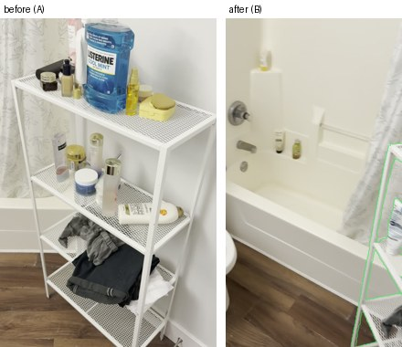
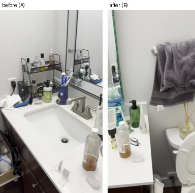
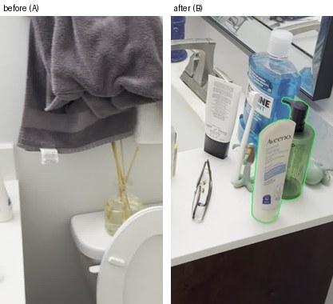
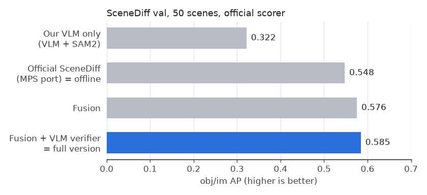
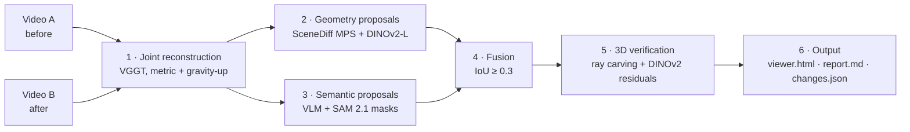

<h1 align="center">Scene Difference</h1>

<p align="center">
  <strong>Two phone videos of a room, taken at different times. Find every object that was added, removed or moved, in 3D.</strong>
</p>

<p align="center">
  <a href="https://chieler.github.io/Scene-difference/"></a>
  <a href="#benchmark"></a>
  
  
  <a href="#run-it"></a>
</p>

<p align="center">
  <a href="https://chieler.github.io/Scene-difference/">
    
  </a>
  <br>
  <sub>The merged point cloud from both videos. Click through to orbit it yourself.</sub>
</p>

<p align="center">
  <a href="#try-it">Try it</a> ·
  <a href="#example">Example</a> ·
  <a href="#benchmark">Benchmark</a> ·
  <a href="#how-it-works">How it works</a> ·
  <a href="#run-it">Run it</a> ·
  <a href="#output">Output</a>
</p>

Both videos are reconstructed into one gravity-aligned, metric 3D frame. Candidate changes from a geometric detector and a vision-language model are cross-checked with 3D ray carving and DINOv2 feature residuals. Every result comes with a plain-English description and an interactive WebGL viewer.

## Features

- **One shared 3D world.** A single joint VGGT pass places both videos in the same metric frame, with no drift and no ICP.
- **Two detectors, fused.** SceneDiff's geometric recall plus a VLM's semantic precision, matched by IoU.
- **Checked in 3D.** The other video's camera rays confirm a change, or prove the object was there all along.
- **Honest about uncertainty.** Changes too small or never seen from the other video are marked *unverified*, not guessed.
- **Runs fully offline.** SceneDiff on Apple Silicon MPS plus CLIP naming, with no API calls.
- **Shareable results.** A single-file Three.js viewer, a Markdown report and `changes.json`.

## Try it

No install needed:

| Viewer | Engine | What you get |
|---|---|---|
| [**Full demo**](https://chieler.github.io/Scene-difference/) | OpenAI VLM + SceneDiff + SAM 2.1 | Named objects, descriptions and 3D boxes |
| [**Offline demo**](https://chieler.github.io/Scene-difference/offline/) | SceneDiff MPS + CLIP, fully local | Zero-shot labels and geometric checks, no API calls |

Or serve them after cloning: `python -m http.server -d docs`, then open `http://localhost:8000`.

| Color | Status | Meaning |
|:---:|---|---|
| 🟩 | **Added** | Only in video B; video A's rays show the space was empty |
| 🟥 | **Removed** | Only in video A; drawn as a ghost cloud in the after model |
| 🟦 | **Moved** | In both, displaced; joined by a metric 3D vector |
| 🟨 | **Unverified** | Under 0.5% of the frame, or the other video never looked there |
| ⬜ | **Unobserved** | Background the other camera never saw |

<details>
<summary><b>Viewer controls</b></summary>

- **Select an object:** click a change card in the sidebar to fly the camera to its 3D box and show the before/after crop.
- **Camera:** left-drag to orbit, right-drag to pan, scroll to zoom.
- **Views:** `Diff` shows the merged cloud with grey unobserved regions and red ghost points. `Video A` / `Video B` show one trajectory each.
- **Show claims rejected by geometry:** toggles candidates ruled out by 3D ray carving.

</details>

## Example

The bundled bathroom pair ([`before.mp4`](examples/input/before.mp4), [`after.mp4`](examples/input/after.mp4); 1080×1920, 9 s each) has one real change:



<sub>The mouthwash bottle moved from the shelf beside the bathtub to the sink counter. Red outlines where it was in the before video; green is where it is now, **3.10 m** away.</sub>

> *"The large blue bottle moved from the top of the white shelf beside the bathtub to the right side of the sink counter."*
> — generated description

```bash
uv run diff.py examples/input/before.mp4 examples/input/after.mp4 -o out/
```

| Status | Change | Object | Shift | Why |
|---|:---:|---|:---:|---|
| ✅ Confirmed | `moved` | Listerine mouthwash bottle | **3.10 m** | Both detectors agree; old and new positions verified in both clouds |
| ❔ Unverified | `removed` | Black toothbrush | — | Under 0.5% of the frame; too small for the ray test |
| ❔ Unverified | `removed` | Small white tissue | — | Too small for ray carving |
| ❔ Unverified | `added` | Small round toiletry item | — | The other camera never covered that angle |
| ❌ Rejected | `added` | Blue-and-white carton | — | 3D rays show it was already there |
| ❌ Rejected | `added` | Mirror edge reflection | — | VLM verifier: viewpoint-dependent specular artifact |
| ❌ Rejected | `added` | White Aveeno lotion bottle | — | Same voxels occupied in both passes |

<details>
<summary><b>See the unverified and rejected crops</b></summary>

| Too small to verify | Rejected by ray carving |
|:---:|:---:|
|  |  |
| **Black toothbrush.** Under 0.5% of the frame, so it is kept as an unverified candidate. | **Blue-and-white carton.** Rays from the other video find the same voxels occupied. |

| Specular artifact | Unchanged object |
|:---:|:---:|
|  |  |
| **Mirror edge.** A viewpoint shift changed the reflection; the VLM verifier vetoes it. | **Aveeno lotion.** Ray carving shows it never moved. |

</details>

## Benchmark

All 50 scenes of the official [SceneDiff](https://github.com/yuqunw/scene_diff) validation split (`varied` subset), scored with the official evaluator ([`bench.py`](bench.py)):



| Method | `obj/im AP` | `obj/sc AP` | `+ type` | `px/im IoU` | TP / FP / FN |
|---|:---:|:---:|:---:|:---:|:---:|
| SceneDiff, MPS port, DINOv2-L (= **offline**) | 0.548 | 0.400 | 0.318 | 0.354 | 94 / 319 / 67 |
| VLM track alone (VLM proposals + SAM 2 masks) | 0.322 | 0.323 | 0.284 | 0.520 | 69 / 45 / 92 |
| **Fusion + verifier, demote rejected** (= **full**) | **0.585** | **0.522** | **0.472** | 0.490 | **110** / 348 / **51** |
| Fusion + verifier, drop rejected | 0.548 | 0.494 | 0.449 | **0.605** | 100 / **91** / 61 |
| Geometry baseline (VGGT + DINOv2 patch diff, 1 scene) | 0.024 | 0.125 | — | 0.008 | — |

> [!NOTE]
> **`obj/im AP`** is the main competition metric: changed-object detection matched per frame. **`obj/sc AP`** matches once per scene, and **`+ type`** also requires the right change type. **`px/im IoU`** is mask overlap with ground truth.

**What the numbers show**

- **More objects found.** Fusion lifts `obj/im AP` from 0.548 to **0.585** (+3.7) and true positives from 94 to **110**. Scene-level typed accuracy rises from 0.318 to **0.472**.
- **Far fewer false alarms.** Dropping claims vetoed by 3D ray carving cuts false positives from 319 to **91** (−71.5%) and lifts mask IoU to **0.605**.
- **Not tuned on the test set.** The variant was picked by 2-fold cross-validation ([`scripts/cv_select.py`](scripts/cv_select.py)); both folds chose "demote rejected".

<details>
<summary><b>Reproduce the benchmark</b></summary>

```bash
# 1. Download the official SceneDiff validation pairs
uv run scripts/fetch_scenediff.py $(cat scripts/val_pairs.txt)

# 2. Run VLM track proposals
uv run scripts/vlm_track.py

# 3. Score the standalone baselines and fusion variants
uv run python bench.py out/pred_vlm
uv run scripts/fuse.py
uv run scripts/verify.py

# 4. Pick the variant with 2-fold cross-validation
uv run scripts/cv_select.py
```

</details>

## How it works



| Stage | Code | What happens |
|---|---|---|
| 1. Joint reconstruction | [`recon.py`](recon.py) | One VGGT forward pass over 24 frames from each video puts both in one frame. RANSAC floor fitting gives metric scale and the up vector. |
| 2. Geometry proposals | [`official.py`](official.py) | An Apple Silicon MPS port of SceneDiff ([`scenediff_mps/`](scenediff_mps/)) turns point-cloud and DINOv2 residuals into candidate masks. |
| 3. Semantic proposals | [`semantic.py`](semantic.py), [`vlm.py`](vlm.py) | The VLM reads time-stamped contact sheets and proposes changes, labels and boxes; SAM 2.1 tracks them into masks. |
| 4. Fusion | [`fusion.py`](fusion.py) | Matches 2D semantic proposals to 3D geometric clusters. |
| 5. Verification | [`semantic.py`](semantic.py) | Casts the other video's camera rays at each candidate's voxels (below). |
| 6. Output | [`viewer.py`](viewer.py) | Packs point clouds, camera frustums and boxes into a self-contained Three.js viewer plus reports. |

Ray verdicts in stage 5:

| Rays from the other video… | Verdict |
|---|---|
| never reach the region | *Unverified* |
| pass through it into empty space | Strong confirmation |
| see DINOv2 features well above the local noise floor | *Confirmed* |

## Run it

**Needs:** macOS (Apple Silicon recommended) or Linux, Python 3.10+ with [`uv`](https://github.com/astral-sh/uv), and `ffmpeg` on `PATH` (`brew install ffmpeg` or `sudo apt install ffmpeg`).

```bash
git clone https://github.com/Chieler/Scene-difference.git
cd Scene-difference
uv sync
bash scripts/setup_scenediff.sh   # downloads SAM ViT-H, π³ and DINOv2 weights
```

| Mode | Command | Notes |
|---|---|---|
| **Full** | `uv run diff.py before.mp4 after.mp4 -o out/` | Most accurate. Needs `OPENAI_API_KEY` or the `codex` CLI |
| **Offline** | `uv run diff.py before.mp4 after.mp4 -o out/ --offline` | Fully local; SceneDiff MPS + CLIP names |
| **Fast** | `uv run diff.py before.mp4 after.mp4 -o out/ --detector fast` | About 8 minutes; skips dense geometry |

> [!TIP]
> With no flag, `diff.py` runs **full** when a VLM backend is available and falls back to **offline** otherwise.

<details>
<summary><b>Runtime and memory on a 16 GB Apple M2</b></summary>

| Stage | Runtime | Peak memory | Notes |
|---|:---:|:---:|---|
| Joint reconstruction (VGGT) | ~5.5 min | 8.2 GB | One 48-frame feed-forward pass |
| SceneDiff proposals | ~22.0 min | 12.7 GB | Apple Silicon MPS; memory freed when done |
| Ray carving + VLM verification | ~3.5 min | 5.1 GB | Multi-view ray projection and feature matching |
| **Total** | **~30 min** | **12.7 GB** | Re-runs with the disk cache take under a minute |

</details>

## Output

```
out/
├── viewer.html     # self-contained interactive Three.js viewer
├── report.md       # summary with crops and status explanations
├── changes/        # crops with outlines (red = before, green = after)
│   ├── 00.jpg
│   └── ...
└── changes.json    # machine-readable records
```

<details>
<summary><b>A <code>changes.json</code> record</b></summary>

```json
{
  "type": "moved",
  "label": "Listerine mouthwash bottle",
  "description": "The large blue bottle moved from the top of the white shelf beside the bathtub to the right side of the sink counter.",
  "status": "confirmed",
  "why": "Both detectors confirmed; old and new 3D positions verified",
  "lo": [0.42, -0.15, 0.85],
  "hi": [0.55, -0.02, 1.12],
  "from_lo": [-1.20, 2.10, 0.90],
  "from_hi": [-1.07, 2.23, 1.17],
  "shift_m": 3.10,
  "evidence": {
    "seen": true,
    "gone": true,
    "differs": true
  }
}
```

</details>

## Repository layout

| Path | Role |
|---|---|
| [`diff.py`](diff.py) | CLI: argument parsing, stage orchestration, caching, export |
| [`recon.py`](recon.py) | Joint two-video VGGT inference, trajectory sync, RANSAC floor fit |
| [`official.py`](official.py) | SceneDiff MPS wrapper for dense candidate masks |
| [`semantic.py`](semantic.py) | VLM proposals, SAM 2.1 segmentation, 3D ray verification |
| [`fusion.py`](fusion.py) | Geometric and semantic proposal matching and re-ranking |
| [`vlm.py`](vlm.py) | OpenAI vision client and crop-sheet verifier |
| [`label.py`](label.py) | Local zero-shot CLIP labels for offline mode |
| [`viewer.py`](viewer.py) | Single-file Three.js viewer generator |
| [`bench.py`](bench.py) | Official SceneDiff metric evaluation |
| [`scenediff_mps/`](scenediff_mps/) | Ported SceneDiff modules, π³ point tracking and patch weights |

## Licenses and attribution

- **SceneDiff:** MIT License (Yuqun Wu et al.), ported to Apple Silicon MPS in [`scenediff_mps/`](scenediff_mps/). See [`scenediff_mps/NOTICE.md`](scenediff_mps/NOTICE.md).
- **π³:** non-commercial research license.
- **Sample videos:** from the [SceneDiff](https://github.com/yuqunw/scene_diff) benchmark (`bathroom_1_bathroom_2`).
- **This project:** MIT License.
