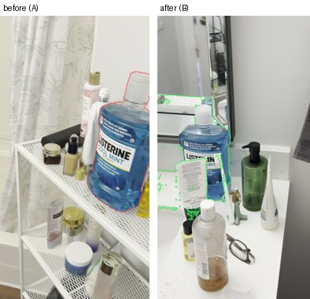
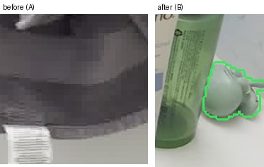

# What changed

- Moved: Listerine mouthwash bottle, 3.1 m, the left of the room. The large blue bottle moved from the top of the white shelf beside the bathtub to the right side of the sink counter. (moved 3.10 m)
  

## Unverified (the other video could not check these)

- Removed: black toothbrush, the left, front of the room. It stood on the vanity beside the mirror, to the right of the sink, and is absent in video B. (too small to check in 3D)
  
- Removed: small white tissue, the left of the room. It lay on the vanity counter near the front of the sink and is absent in video B. (too small to check in 3D)
  
- Added: small round toiletry item, the left of the room. It sits at the back right of the vanity counter, beside the green pump bottle, and is absent in video A. (too small to check in 3D)
  

## Rejected (contradicted in 3D, or vetoed by the VLM)

- Added: Blue-and-white carton, the right, back of the room. A blue-and-white carton stands on the second level of the white shelf beside the bathtub, in front of the taller toiletries. (the other video sees the same thing there)
  
- Added: mirror edge, the left, front of the room. The outlined edge of the mirror above the vanity stays in the same place relative to the sink. (the VLM sees no change here)
  
- Added: White Aveeno lotion bottle, the left of the room. A white Aveeno bottle sits near the front right corner of the sink counter, beside the mouthwash. (the other video sees the same thing there)
  
