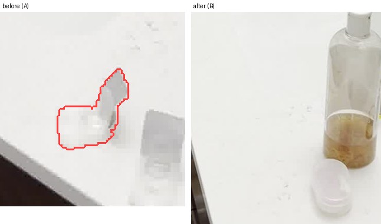
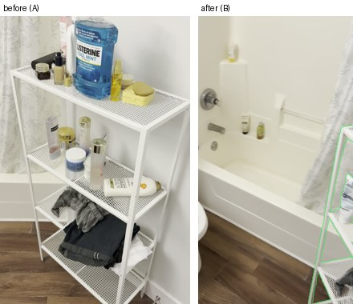

# What changed

- Moved: bottle, 3.1 m, the left of the room. (moved 3.14 m)
  
- Moved: bottle, 0.2 m, the right of the room. (moved 0.22 m)
  

## Unverified (the other video could not check these)

- Removed: box, the left, front of the room. (too small to check in 3D)
  
- Added: toy, the left of the room. (too small to check in 3D)
  
- Removed: chair, the left of the room. (too small to check in 3D)
  

## Rejected by geometry (claimed by the VLM, contradicted in 3D)

- Added: shelf, the right, back of the room. (the other video sees the same thing there)
  
- Added: mirror, the left, front of the room. (the other video sees the same thing there)
  
